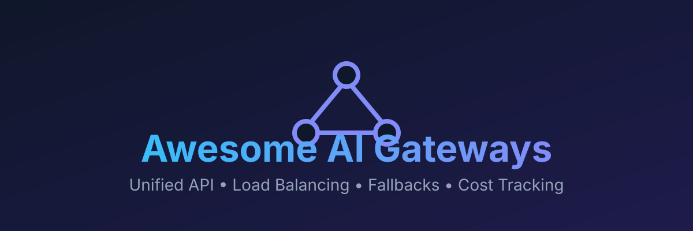
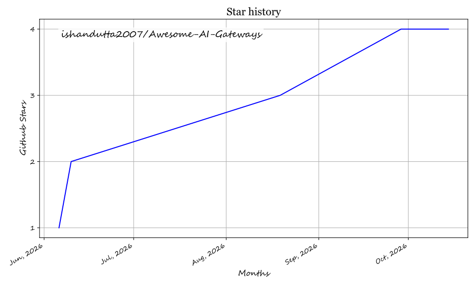

<div align="center">
  

  <h1>🚀 Awesome AI Gateways</h1>

  <p><strong>A curated list of the best AI Gateways, LLM Routers, and Proxies to unify OpenAI, Anthropic, Gemini, and more.</strong></p>

  <p>
    <a href="https://github.com/ishandutta2007/Awesome-Awesome-Awesome"></a><a href="https://discord.gg/jc4xtF58Ve"></a>
    
    
    
    
    
	<a href="https://github.com/ishandutta2007"></a>
  </p>

  <h4>Unified API • Load Balancing • Fallbacks • Cost Tracking • Observability</h4>
</div>

---

## 🌟 Introduction

This repository is an SEO-optimized, curated ecosystem of **SaaS platforms** and **Open-Source projects** for building **AI Gateways**. These intelligent proxies act as a unified bridge to multiple LLM providers, ensuring high availability, performance, and significant cost savings.

### 🔄 How it Works
<div align="center">
  
</div>

---
## 🧭 Which Gateway Should I Use?

Not sure where to start? Use this quick guide:

| Your situation | Recommended option |
|---|---|
| Student or beginner experimenting with LLMs | OpenRouter (1M free req/mo) or LangChain |
| Building a production app and need observability | Portkey or Helicone |
| Want everything self-hosted and private | LiteLLM open-source |
| Need edge performance and global scale | Cloudflare AI Gateway |
| Building AI agents with complex routing logic | LangChain / LangGraph |
| Running local models on your own machine | Ollama + Open WebUI |
| Enterprise with budget management and SSO | LiteLLM Cloud |

---

## 📑 Table of Contents
- [🌐 SaaS Products](#-saas-products)
  - [📈 Sector Overview & Market Dynamics](#-sector-overview--market-dynamics)
  - [📊 Core AI Gateway Comparison](#-core-ai-gateway-comparison)
- [🏗️ Open-Source GitHub Projects](#-open-source-github-projects)
- [🤝 How to Contribute](#-how-to-contribute)
- [💖 Support](#-support)
- [⚖️ Disclaimer](#-disclaimer)

---

## 🌐 SaaS Products

### 📈 Sector Overview & Market Dynamics

The global AI Gateway, LLM routing, and API proxy market is estimated to expand from **$1.8B in 2024 to over $12B+ by 2030** (projected CAGR of ~38%), propelled by enterprise multi-model adoption and the rise of autonomous agent architectures. The sector is currently **moderately to highly fragmented** rather than a winner-take-all landscape—cloud edge giants (like Cloudflare) dominate global network caching, major open-source standards (LiteLLM, vLLM) lead private on-prem deployments, and innovative developer-first startups compete actively on smart cost routing, failovers, and compliance governance.

### 📊 Core AI Gateway Comparison

| SaaS Product | Company Size (Valuation/Revenue) | Pricing Model | Free Tier Limit | Key Features |
| :--- | :--- | :--- | :--- | :--- |
| **[Cloudflare AI Gateway](https://developers.cloudflare.com/ai-gateway/)** ☁️ | ~$76B Valuation | Usage-based | 100,000 logs/month | Edge-native gateway with powerful caching, rate limiting, unlimited requests, and global performance benefits. |
| **[OpenRouter](https://openrouter.ai/)** 🚀 | ~$1.3B Valuation | 5.5% Platform Fee | 1M req/mo (BYOK) | Leading intelligent router that aggregates dozens of LLMs with smart model routing, fallback, and competitive pricing. |
| **[Portkey](https://portkey.ai/)** 🔑 | ~$130M (Acquired) | $49/mo+ | 10,000 logs/month | Full-featured AI gateway with observability, caching, guardrails, and multi-provider routing. |
| **[Helicone](https://helicone.ai/)** 🔦 | ~$25M Est. (Acquired by Mintlify, ~$500M Valuation) | $79/mo+ | 10,000 requests/month | Popular observability platform for LLMs with easy integration via proxy or SDK, custom properties, and cost tracking. |
| **[PromptLayer](https://promptlayer.com/)** 📑 | ~$4.8M Valuation | $49/mo+ | 2,500 requests/month | Specialized platform for prompt engineering, management, versioning, evaluation middleware, and tracking production LLM usage. |
| **[Requesty](https://www.requesty.ai/)** 🧭 | ~$3M Raised | 5% markup on model costs | 1,000 req/day on free models | Go-based OpenAI-compatible router for 600+ models across 30+ providers with cost/latency/availability-based routing, failover chains, prompt caching, BYOK, budget caps, RBAC, and EU data residency. |
| **[LiteLLM Cloud](https://litellm.ai/)** 🛡️ | ~$2.1M Raised | $250/mo+ | 7-30 day trial | Managed proxy with RBAC, budget management, SSO, unified API, advanced routing, logging, and cost management features. |
| **[Glama](https://glama.ai/)** 💎 | Bootstrapped | $9/mo+ | Free MCP hosting | Modern AI gateway focused on performance, reliability, developer-friendly features, and MCP server hosting. |
| **[XiuRouter](https://router.xiu.ai/)** | Independent / XiuLab Inc (Bootstrapped) | Usage-based prepaid | — | Managed multi-model API with OpenAI Responses and Chat Completions, Anthropic Messages, and Gemini GenerateContent interfaces, scoped API keys, and per-request usage and cost records. |
| **[APIClaw](https://apiclaw.biz)** | Independent / Bootstrapped | Flat-rate $19–$129/mo | 50 free trial | OpenAI-compatible AI API gateway for Claude, GPT, Kimi, Qwen, DeepSeek, and GLM. |
| **[Standard Compute](https://standardcompute.com/)** | Independent gateway | Monthly plans $19–$2,499/mo with a fixed compute budget | $0.25 trial compute (eligible new accounts, no card) | OpenAI- and Anthropic-compatible router for coding agents that sends each request to a model chosen for cost; requests stop with HTTP 402 at the monthly budget instead of billing overage. |
| **[Prism API](https://github.com/go165/prism-api-promo)** | Independent / Bootstrapped | Usage-based | Google signup trial balance | Independent OpenAI-compatible gateway for overseas developers, with low-cost GPT-5.5 access, quota controls, and crypto-friendly recharge/voucher options. |
| **[RunAPI](https://runapi.ai)** | Independent / Bootstrapped | Usage-based | — | OpenAI-compatible gateway for running image, video, music/audio, and model API jobs from one endpoint. |
| **[TeamoRouter](https://teamorouter.com/blogs/gpt-6-astra-what-is)** | Independent / Bootstrapped | Paid (usage-based prepaid) | — | Hosted multi-model gateway with agentic routing for coding agents, OpenAI/Anthropic/Gemini-compatible endpoints, and `gpt-6-astra` access (1.05M-token context), with Alipay payment support. |

---

## 🏗️ Open-Source GitHub Projects

### 🛠️ Dedicated AI Gateway & Proxy Solutions

- **[Open WebUI](https://github.com/open-webui/open-webui)** [](https://github.com/open-webui/open-webui/stargazers) 🐳  
  Complete local LLM platform with robust API gateway and multi-model routing capabilities.

- **[vLLM](https://github.com/vllm-project/vllm)** [](https://github.com/vllm-project/vllm/stargazers) ⚡  
  High-performance inference server with custom gateway layers for production LLM routing.

- **[LiteLLM](https://github.com/BerriAI/litellm)** [](https://github.com/BerriAI/litellm/stargazers) ⭐  
  The most popular open-source LLM proxy and gateway. Supports 100+ models with unified OpenAI-compatible API, load balancing, fallback, caching, logging, and cost tracking.

- **[New API](https://github.com/Calcium-Ion/new-api)** [](https://github.com/Calcium-Ion/new-api/stargazers) 🌐  
  Unified AI model hub and proxy supporting multi-provider aggregation, key redistribution, and bidirectional format cross-conversion across OpenAI, Claude, and Gemini APIs.

- **[LocalAI](https://github.com/mudler/LocalAI)** [](https://github.com/mudler/LocalAI/stargazers) 🤖  
  Self-hosted drop-in replacement for OpenAI with support for many backends and gateway features.

- **[FastChat](https://github.com/lm-sys/FastChat)** [](https://github.com/lm-sys/FastChat/stargazers) 💬  
  Open platform for training, serving, and evaluating chatbots with multi-model gateway support.

- **[One API](https://github.com/songquanpeng/one-api)** [](https://github.com/songquanpeng/one-api/stargazers) 🔑  
  Pioneer open-source LLM API management and key redistribution platform unifying OpenAI, Anthropic, Gemini, Azure, and dozens of models under a single interface.

- **[Portkey Gateway](https://github.com/Portkey-AI/gateway)** [](https://github.com/Portkey-AI/gateway/stargazers) 🧩  
  Open-source core of Portkey with powerful routing, observability, and guardrails capabilities.

- **[TensorZero](https://github.com/tensorzero/tensorzero)** [](https://github.com/tensorzero/tensorzero/stargazers) 🦀  
  High-performance Rust-based LLM gateway and LLMOps platform unifying multi-model routing, fallbacks, observability, prompt optimization, and evaluation.

- **[Higress](https://github.com/alibaba/higress)** [](https://github.com/alibaba/higress/stargazers) ⛩️  
  Next-generation cloud-native AI gateway originated from Alibaba and CNCF, built on Envoy and Istio with native multi-LLM routing, token-level rate limiting, and caching.

- **[Bifrost](https://github.com/maximhq/bifrost)** [](https://github.com/maximhq/bifrost/stargazers) 🚦<br>
  Go-native OpenAI-compatible AI gateway with multi-provider routing, failover, guardrails, usage controls, MCP support, and observability.

- **[Arch](https://github.com/katanemo/arch)** [](https://github.com/katanemo/arch/stargazers) 🏛️  
  Intelligent AI-native prompt gateway and proxy designed for agentic workflows, providing prompt routing, latency optimization, guardrails, and agent orchestration.

- **[RouteLLM](https://github.com/lm-sys/RouteLLM)** [](https://github.com/lm-sys/RouteLLM/stargazers) 🎯  
  LMSYS framework for serving and evaluating cost-effective LLM routers, dynamically routing simpler queries to lighter models and complex prompts to reasoning models without quality degradation.

- **[Envoy AI Gateway](https://github.com/envoyproxy/ai-gateway)** [](https://github.com/envoyproxy/ai-gateway/stargazers) 🛡️  
  Official Envoy Gateway extension for Generative AI, providing enterprise traffic management, unified LLM API access, token rate limiting, and observability.

- **[OpenRouter Self-Hosted](https://github.com/search?q=openrouter+self+hosted)** 🏠  
  Community self-hosted routers inspired by OpenRouter with multi-provider support.

- **[DaoXE](https://github.com/seven7763/DaoXE-AI)** [](https://github.com/seven7763/DaoXE-AI/stargazers) 🔌  
  Multi-model multi-protocol AI API gateway for developers (Chat Completions, Responses, Anthropic Messages, image-compatible endpoints)

### 📦 Additional Strong Open-Source Options

- **[Dify](https://github.com/langgenius/dify)** [](https://github.com/langgenius/dify/stargazers) — AI app platform with built-in model routing and gateway.
- **[LangChain](https://github.com/langchain-ai/langchain)** [](https://github.com/langchain-ai/langchain/stargazers) is an open-source framework for building LLM-powered applications with built-in support for routing between multiple providers including OpenAI, Anthropic, Google Gemini, and more.
- **[LangGraph](https://github.com/langchain-ai/langgraph)** [](https://github.com/langchain-ai/langgraph/stargazers) extends this with stateful, multi-agent orchestration and conditional routing logic.
- **[Semantic Kernel](https://github.com/microsoft/semantic-kernel)** [](https://github.com/microsoft/semantic-kernel/stargazers) — Microsoft’s AI orchestration with gateway-like features.

**Best for:** Developers building AI agents, RAG pipelines, and multi-step reasoning applications that need flexible, code-driven model routing.

**Key features:**
- Unified interface across 50+ LLM providers
- Built-in memory, tool calling, and agent frameworks
- LangGraph enables complex conditional routing between models
- Active community and extensive documentation

**Quick start:**
```python
from langchain_anthropic import ChatAnthropic
from langchain_openai import ChatOpenAI

# Switch providers with one line — same interface
model = ChatAnthropic(model="claude-sonnet-4-20250514")
model = ChatOpenAI(model="gpt-4o")
```

---

## 🤝 How to Contribute

1. Fork the repo.
2. Add/edit entries in `README.md` (follow existing format).
3. Include: name, link, 1–2 sentence description, and whether it's SaaS or open-source.
4. Submit PR with a short explanation.


<a href="https://github.com/ishandutta2007"></a>


---

## 💖 Support

Thank you for exploring and using **Awesome AI Gateways**! If this curated guide helps you in your AI journey or saves you time, please consider supporting the project:

- ⭐ **Star this repo** on GitHub to help other engineers and teams discover it.
- 🍴 **Fork & contribute** your favorite gateways, routers, fixes, and recommendations.
- 📢 **Share it** on X / Twitter, LinkedIn, Reddit, and developer communities.
- ☕ **Buy me a coffee / Sponsor:** If you'd like to support ongoing maintenance and new features, consider sponsoring via the [GitHub Sponsor Dashboard](https://github.com/sponsors/ishandutta2007).

<div align="center">
  <a href="https://github.com/sponsors/ishandutta2007">
    
  </a>
</div>

---

## ⚖️ Disclaimer

- This is a **community-curated** list — not exhaustive and not an endorsement.
- Self-hosted open-source gateways require proper security, monitoring, and rate limiting configuration.

---

## 📈 Star History

<div align="center">
	<a href="https://www.star-history.com/?repos=ishandutta2007%2FAwesome-AI-Gateways&type=date&legend=bottom-right">
	 <picture>
	   <source media="(prefers-color-scheme: dark)" srcset="https://api.star-history.com/chart?repos=ishandutta2007/Awesome-AI-Gateways&type=date&theme=dark&legend=bottom-right" />
	   <source media="(prefers-color-scheme: light)" srcset="https://api.star-history.com/chart?repos=ishandutta2007/Awesome-AI-Gateways&type=date&legend=bottom-right" />
	   
	 </picture>
	</a>
</div>

---

**Made for AI engineers, developers, and teams building scalable LLM applications.**  
Let's make LLM access more reliable, private, and cost-effective.

## ⭐ Star History

<a href="https://star-history.com/#ishandutta2007/Awesome-AI-Gateways&Timeline" align="center">
  <picture>
    <source media="(prefers-color-scheme: dark)" srcset="assets/ishandutta2007_Awesome-AI-Gateways_growth.svg">
    
  </picture>
</a>
